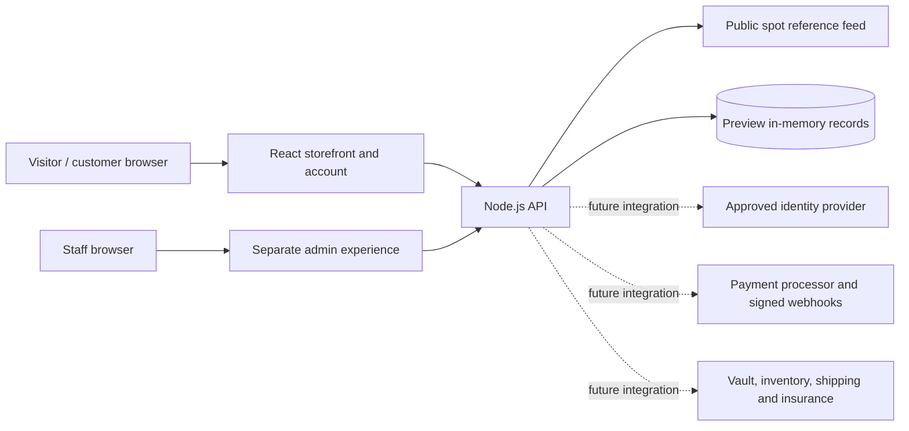

# Gold Investment — Project Blueprint

**Product:** Global precious-metals marketplace preview  
**Metals:** Physical gold and silver  
**Display currency:** USD  
**Current purchase minimum:** $10,000 eligible-metal subtotal per order  
**Status:** Runnable React and Node.js previewnstration; not yet ready to accept real payments or provide custody.

## 1. Product purpose

Gold Investment is designed to let customers explore physical bullion, review USD spot-price references, create an account, choose delivery or vault storage, and move through a purchase workflow. Staff have a separately branded administration area for reviewing preview inventory, orders, customers, and audit events.

The current project is a functional preview of the storefront and server-side validation. Spot prices, catalog stock, fees, tax, identity checks, payment choices, custody, and fulfillment are not all connected to production providers. Nothing in this preview should be represented as an executed trade, confirmed ownership, or real vault balance.

## 2. System overview



The customer and admin interfaces are separate experiences within one deployment. The admin area is not isolated on its own domain or infrastructure. The server is the authority for quotes, minimums, session identity, and protected admin changes; a browser display alone is not trusted to authorize an order or mark payment as settled.

## 3. Roles

| Role | Main capabilities | Current preview boundary |
| --- | --- | --- |
| Visitor | Browse prices, products, information and policies | No transaction is executed |
| Customer | Register, sign in, view account activity, configure checkout preference | Account and order records are in memory; payment and custody are not connected |
| Staff administrator | Review preview summary, products, stock, orders, customer flags and audit events | One shared `ADMIN_TOKEN`; no staff accounts, MFA or role separation |
| External providers (future) | Verify identity, collect payment, custody/ship metals | Not configured; must be integrated before accepting real orders |

## 4. Page map

### Public storefront

`/`, `/how-it-works`, `/prices`, `/shop`, `/shop/gold`, `/shop/silver`, `/products/:slug`, `/calculator`, `/sell`, `/delivery`, `/security`, `/help`, `/contact`, `/returns`.

The homepage presents the metal-price reference, featured bullion, buy/sell calls to action, video and image slides, Saudi market imagery, and delivery/vault messaging. English and Arabic (Saudi Arabia) are available; Arabic is the first-visit default. USD remains the price currency. The requested Saudi market photos and external video clips are editorial inspiration and do not establish that a pictured seller is verified or has stock.

### Sign-in and customer account

`/register`, `/login`, `/account`, `/account/metals`, `/account/transactions`, `/account/orders`, `/account/orders/:id`, `/account/orders/:id/tracking`, `/account/addresses`, `/account/settings`, `/account/notifications`, `/account/documents`, `/account/funds`, `/account/trade`, `/account/explore`, `/account/customer-care`.

Registration collects first and last name, country, state/province, city, delivery address, and account credentials. Country/state/city choices are loaded from the CountriesNow public location directory; if the directory is unreachable, state and city can be entered manually. The dashboard navigation covers Dashboard, Vault, Transactions, Fund & withdraw, Buy & sell, Explore, Settings, and Customer care center. Settings separates editable account details from Security information. Money movement and vault custody remain unavailable previews.

### Cart and checkout

`/cart`, `/checkout`, `/checkout/payment`, `/checkout/success`, `/order-status/:id`.

Checkout is designed around an order quote, identity/address completion, payment, and a verified result. Existing customers skip repeat identity/address entry only when the authenticated server profile has both provider-set `identityProviderVerified=true` and `verificationStatus=verified`. After a payment provider is integrated, only a server-verified paid status should return the customer to their account dashboard.

### Legal and policy pages

`/legal/terms`, `/legal/privacy`, `/legal/cookies`, `/legal/pricing`, `/legal/shipping`, `/legal/refunds`, `/legal/risks`, `/legal/tax`.

Policy copy is a product preview and needs review for every jurisdiction where the service may operate.

### Administration

`/admin/login`, `/admin`, `/admin/orders`, `/admin/inventory`, `/admin/products`, `/admin/pricing`, `/admin/customers`, `/admin/payments`, `/admin/fulfillment`, `/admin/promotions`, `/admin/support`, `/admin/reports`, `/admin/staff`, `/admin/audit-logs`, `/admin/settings`.

The admin shell has separate navigation and uses server-side token checks for its protected APIs. A separate visual shell is not a separate security boundary.

## 5. Core customer journeys

### Browse and buy

1. Customer browses gold or silver bars and coins and chooses a product and quantity.
2. The cart shows the eligible-metal subtotal and blocks checkout below $10,000.
3. The server obtains current spot references, checks catalog items and quantities, then returns a quote including the configured illustrative fees and tax estimate.
4. A price difference requires the customer to review and accept the updated amount.
5. The customer chooses vault or delivery and completes identity/address checks through a future approved provider.
6. A payment provider collects payment and sends a signed webhook to the server.
7. The server records settlement, reserves/allocates inventory, and only then allows fulfillment and dashboard updates.

Steps involving identity, payment, vault, shipment, and settlement are not active in the current preview. The browser's local ID/selfie completeness checks are not identity verification or liveness proof.

### Returning verified customer

1. Customer signs in and starts a new order.
2. The server loads the saved profile for that authenticated session.
3. If the trusted identity provider previously set both required verified flags, checkout can skip the repeat identity/address step and continue to payment.
4. The payment provider confirms settlement to the server; a browser redirect alone cannot mark the order paid.
5. Once the server confirms paid status and order ownership, the customer may return to the dashboard.

### Sell gold or silver

The UI can present an illustrative quote, but sell-order creation is disabled by default. Production selling requires trusted identity verification, independent metal inspection, a defined shipping/receipt process, pricing rules, and a compliant payout provider. Do not enable the workflow flags before those services and controls are ready.

## 6. Business rules and quote composition

- Purchase minimum: **$10,000 USD combined eligible-metal subtotal per cart/order**, before fees and tax. The browser disables the action below the threshold and the server validates it again.
- Sell request estimate: **$10,000 USD per metal** after an illustrative 5% buyback adjustment. Sell order creation is disabled by default.
- Currency: USD in both English and Arabic site modes. Arabic language selection does not imply SAR pricing or Saudi delivery availability.
- Market data: Gold API XAU/XAG spot reference, polled every five seconds, with clearly labeled mock fallback. Spot is indicative, not an executable dealer quote.
- Product price: reference spot value plus illustrative product premium. Final production quote must use actual available inventory and provider/dealer pricing.
- Fees and taxes: default illustrative delivery fee $25, vault fee $10, and general 8% estimate. The same rate is currently used for every country; it is not jurisdictional tax calculation.
- Delivery and vault: preferences are recorded in preview only. No parcel, custody account, insurance, or metal allocation is created.
- Price changes: checkout must show changed quote and require customer acceptance; the order API performs final server-side checks.

## 7. Backend/API outline

The Node.js API currently exposes:

| Endpoint | Purpose |
| --- | --- |
| `GET /api/health` | Service health |
| `GET /api/prices` | Gold/silver spot references and source/fallback state |
| `GET /api/products` | Product catalog |
| `POST /api/quote` | Recalculate cart quote server-side |
| `POST /api/orders` | Validate and create a preview purchase order |
| `POST /api/sell/quote` | Return illustrative sell estimate |
| `POST /api/sell/orders` | Disabled by default; gated sell workflow |
| `POST /api/auth/signup`, `POST /api/auth/login`, `POST /api/auth/logout` | Preview account and session operations |
| `GET /api/auth/me` | Current authenticated customer |
| `GET /api/account/dashboard` | Customer dashboard data |
| `PATCH /api/account/profile` | Validate and update signed-in name, email, phone, address, and location fields |
| `GET /api/account/checkout-profile` | Authenticated profile and trusted verification flags |
| `GET /api/account/orders/:id/payment-status` | Verify an owned order's server-side payment status |
| `GET /api/admin/summary` | Admin summary (token protected) |
| `PATCH /api/admin/products/:id`, `/api/admin/orders/:id`, `/api/admin/customers/:id` | Protected preview administration and audit entries |

### Main records (target model)

- **Customer:** ID, normalized email, password hash, name, country, delivery address, identity-provider reference/status, timestamps.
- **Product:** ID/slug, metal, type, weight, purity, premium, display image, inventory availability.
- **Quote:** customer/session, items and quantities, spot snapshot and timestamp, premiums, fees, tax estimate, total, custody choice, expiry and acceptance.
- **Order:** customer, quote snapshot, order state, payment state, inventory reservation, fulfillment state, timestamps.
- **Payment event:** provider reference, amount/currency, verified webhook ID/signature result, settlement/refund status.
- **Audit event:** actor, action, target, timestamp, request context and before/after summary.

Current preview users, sessions, quotes, orders, and audit events are held in process memory and disappear when the server restarts. These are design concepts, not a durable database implementation.

## 8. Security and trust boundaries

Already present in the preview: server-side minimum/quote validation, account session cookies marked HTTP-only and same-site, scrypt password hashes, authenticated profile lookup, verification flags that only a trusted provider should set, quote expiry/change checks, protected admin APIs, basic process-memory login/signup throttles, and admin audit events.

Not present / production hardening required: durable encrypted database, distributed rate limiting, CSRF strategy, email verification and account recovery, MFA, per-staff roles and dual approval, secrets manager, security monitoring/alerting, privacy retention/deletion controls, independent penetration review, identity-provider callbacks, payment processing and signed webhooks, inventory reservation/ledger, operational reconciliation, and jurisdictional legal/compliance controls.

The in-browser face detector only helps frame a face. It does not establish a live person or verify an identity. Documents selected in the preview remain local to the browser and are not safely collected, authenticated, or persisted by a verification service.

## 9. Production launch roadmap

### P0 — Establish operating scope

Select launch countries and states, define permitted products and destinations, obtain legal/privacy/tax review, contract a bullion supplier/dealer, and determine whether the business can legally sell, buy back, store, or ship metals in each market.

### P1 — Replace preview data and persistence

Use a commercially licensed pricing source and executable quote policy; add a durable database, encrypted sensitive records, inventory reservations, idempotent order creation, backups, and reconciliation.

### P2 — Identity and payment

Integrate an approved identity/address and liveness provider. Integrate a regulated payment processor for supported regions, implement signed webhooks, refunds and reconciliation. Do not accept card or crypto credentials in the app itself.

### P3 — Fulfillment and custody

Contract and integrate insured carriers and vault custodian, define custody statements and ownership records, shipment tracking, loss/damage procedures, service-level support, and verified delivery workflows.

### P4 — Staff controls and operations

Replace the shared admin token with staff identities, MFA, least-privilege roles, dual approval for sensitive actions, monitored immutable audit storage, incident response, and operational reporting.

### P5 — Readiness review

Test payment and identity provider sandbox flows, quote expiry/race conditions, inventory races, access controls, cross-border restrictions, accessibility and responsive layouts. Complete security, legal, tax, privacy and financial compliance sign-off before handling customer funds or identity documents.

## 10. Run the project locally

Requirements: Node.js 20 or newer.

```sh
npm install
npm run dev
```

Open <http://localhost:3000>. Vite serves the React app and proxies API calls to the Node server on port 3001.

To build and serve the production bundle locally:

```sh
npm run build
npm start
```

Open <http://localhost:3001>. Copy `.env.example` to `.env` and replace the sample admin token before exercising protected admin pages. Never commit `.env` or use the preview token in a deployed service.

## 11. Project technology

- React 19, React Router 7, Vite 6
- Node.js API server
- `@mediapipe/tasks-vision` for client-side face framing preview only
- Gold API public XAU/XAG endpoints for displayed spot references
- Responsive CSS with reduced-motion handling

## 12. Definition of a real transaction

The project should only present a purchase as successful when the server has verified the signed payment-provider event, matched the amount and currency to an unexpired accepted quote, reserved inventory, and persisted the order state. It should only show metal as customer-owned after the business's documented payment, allocation, and settlement rules are met. A return URL, client-side success state, identity checklist, market photo, or spot-price display is not evidence of a completed trade or ownership.
